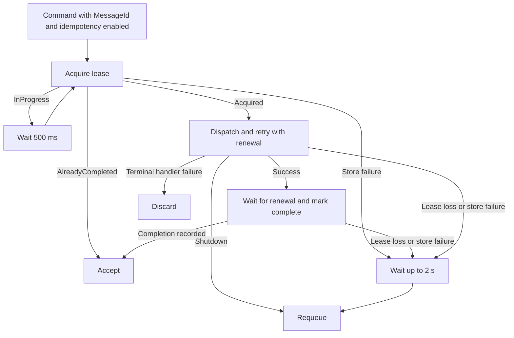

# Architecture

**Messaging.Abstractions** defines contracts for handlers, producers, RPC, and deduplication stores. **Messaging.RabbitMQ** owns AMQP connections, topology, publishing, command delivery, and RPC requesters and responders. The sample projects demonstrate commands and RPC.

The command consumer passes deliveries to a scoped dispatcher. Retries and backoff run under the same lease. With idempotency disabled or a missing MessageId, dispatch still uses retries. With idempotency enabled, the key is `queue:messageId`. The consumer acknowledges a completed duplicate. If another lease is active, it checks the store every 500 ms.

`MessageLeaseManager` renews the lease every third of the processing timeout, up to a one-minute interval. The minimum processing timeout is 3 ms. The manager waits for any in-flight renewal before marking the message complete. On lease loss or store failure, it signals cancellation and the consumer requeues after a 2 s delay. Shutdown interrupts that delay. A terminal failure calls `Discard`. Dead-lettering depends on broker topology and policies.



On failure, release uses the owner's token and a separate two-second cancellation budget. A handler that ignores cancellation can delay settlement and continue producing side effects after lease loss. Store providers need to honor cancellation and enforce their own I/O deadlines. Completion and business side effects are separate operations. The in-memory store keeps state within one process.

The command consumer uses configured AMQP credit and a separate `MaxConcurrency` limit on active callbacks per queue. Actual parallelism depends on the AMQP client. Concurrent lease tests invoke the delivery handler with controlled inputs. The RPC responder has its own lifecycle and operates outside command leasing.

`Idempotency.Provider` must match the keyed DI registration of `IMessageDeduplicationStore`. The built-in default key is `InMemory`. Register custom providers as keyed singletons. Applications that previously used an unkeyed override need to migrate that registration. Configuration validation runs even when idempotency is disabled. The in-memory store checks up to 64 entries every 64 acquire operations and removes only unchanged expired entries. Expired entries can remain until the store receives more traffic.

`CourierLane.Idempotency.Redis` shares the processing timeout and retention settings. Lua scripts compare the lease token and update the value or TTL atomically on one Redis key. Operations in one DI container share a Redis connection. The key includes a configurable prefix and RabbitMQ virtual host. Use different prefixes for independent deployments that share Redis and have the same virtual host.

Register the provider with the `RabbitMessaging:Idempotency:Redis` section and set `RabbitMessaging:Idempotency:Provider` to `Redis`. Supply `ConnectionString` through an environment variable or secret store. The default `KeyPrefix` is `messaging:idempotency:`.

```csharp
using Messaging.Idempotency.Redis;

var rabbit = builder.Configuration.GetSection("RabbitMessaging");
builder.Services.AddRabbitMessaging(rabbit);
builder.Services.AddRedisIdempotency(rabbit.GetSection("Idempotency:Redis"));
```

Cancellation stops the client waiting for a reply. Redis can still execute a command already sent, and its TTL limits the lifetime of any resulting lease. Expiry, eviction, loss of unpersisted records, and failover can cause duplicate processing. The restart test replaces client DI containers while Redis stays running.

## Events

`IEventPublisher` publishes to a topic exchange with the registered event type ID as the routing key and waits for an AMQP outcome. The listener or infrastructure declares the exchange before publishing. All instances of one logical subscriber use the same exchange and subscriber name.

```csharp
builder.Services.AddRabbitMessageContracts(contracts =>
    contracts.Register<OrderCreatedEvent>("orders.created.v1"));
builder.Services.AddRabbitEventListener(events =>
    events.Subscribe("business.events", "orders-projection")
        .Handle<OrderCreatedEvent, OrderCreatedHandler>("orders.created.v1"));
// IEventPublisher publisher
await publisher.PublishAsync("business.events", new OrderCreatedEvent(orderId), cancellationToken);
```

Handlers implement `IEventHandler<TEvent>`. The default `Broadcast` mode creates a unique, exclusive, auto-delete classic queue per instance and requires `Consumer.AutoDeclare`. Each active instance gets its own delivery and deduplication scope. Offline instances miss events. The topology and consumer links are recovered by the AMQP client. Subscribers can miss deliveries during a disconnect. A process restart creates a new queue.

`WithDeliveryMode(EventDeliveryMode.CompetingConsumers)` uses a shared durable queue named from the exchange and subscriber. With dead-lettering enabled, both modes use a durable quorum DLQ for the logical subscriber. Broker metadata for a broadcast delivery can reference a temporary queue that no longer exists. Keep the record in the DLQ or archive until an explicit replay target is available. Publishing back to the topic exchange would redeliver to other subscribers.

## DLQ management

Quorum source queues add `x-opt-messaging-failure` on terminal rejection. The value is an error code without an exception message, stack trace, or payload. For classic source queues, including broadcast, the available reason comes from broker metadata. [RabbitMQ AMQP 1.0](https://www.rabbitmq.com/client-libraries/amqp-client-libraries)

The Management API reads a local SQLite archive with opt-in ingestion. Set `DeadLetterManagement:DatabasePath` to a persistent file and `DeadLetterManagement:Sources` to a map from DLQ names to explicitly allowed destination queues. An empty target list allows archiving without replay. Enabling ingestion moves messages from the DLQ into the archive. The consumer acknowledges delivery after the archive write. A fingerprint deduplicates redeliveries of the same queue, MessageId, payload, and replay attempt. Messages without a string MessageId can create duplicate archive records. The archive retains the body, content type, string MessageId and CorrelationId, message type, supported application headers, and selected broker annotations. Replay restores application metadata while broker annotations describe the new delivery. [RabbitMQ HTTP API](https://www.rabbitmq.com/docs/http-api-reference)

Replay uses an allowlist and addresses the original queue. If the queue is gone and the broker definitively rejects the publish, the record stays `Pending`. `MaxReplayAttempts` defaults to 1. The counter carries over if the replay is dead-lettered again. A single request can claim `Replaying` and records `Replayed` after broker confirmation. An uncertain result or crash leaves the record in `Replaying` for operator review. Automatically retrying could send another copy with the same MessageId. The API has no reset operation for an uncertain replay. `Discard` clears the payload, CorrelationId, and headers from the logical record. SQLite files and backups have their own retention lifecycle.

The web host uses `ManagementIdentity:Authority` as the HTTPS issuer and `ManagementIdentity:Audience` as the audience. The `/api/dead-letters` API uses bearer authentication and identifies the operator through `sub` or `NameIdentifier`. Claim type `messaging.dlq` grants separate permissions through values `messaging.dlq.read`, `messaging.dlq.payload`, `messaging.dlq.replay`, `messaging.dlq.archive`, and `messaging.dlq.discard`. Details require both read and payload access. Batches accept up to 20 IDs. The audit record is written atomically with the status change and excludes the payload. The web UI holds the token in page memory and asks for confirmation before changes. Deploy over HTTPS with persistent local storage for SQLite.

## SQL idempotency providers

Call `AddPostgreSqlIdempotency(rabbit.GetSection("Idempotency:PostgreSql"))` and select `PostgreSql` in `Idempotency.Provider`. Supply `ConnectionString` through a secret store. Call `AddSqliteIdempotency(rabbit.GetSection("Idempotency:Sqlite"))` and select `Sqlite` with a persistent local `DatabasePath`.

The migration creates `messaging_idempotency_v1` and an expiry index before the listener starts. PostgreSQL serializes concurrent migrations through an advisory transaction lock. The runtime account needs permission to create the table and index at first startup. Both providers use a unique key scoped by `KeyPrefix` and virtual host, atomic token-checked changes, and cleanup of up to 64 rows every 64 acquire operations. SQLite uses WAL on a local disk. PostgreSQL lets separate processes share a store.

## Message metadata

The existing `SendAsync` and `PublishAsync` overloads remain available. The metadata overloads take `SendOptions` and an explicit `CancellationToken`. RPC uses `RequestOptions.Metadata`. The publisher generates a GUID MessageId when the caller omits it. Timestamps are UTC. RPC `CorrelationId` is a logical application property and the AMQP requester matches replies with a separate native value. Custom headers are string pairs. Reserved names and the `messaging-` and `x-` prefixes are protected. Routing uses the registered versioned contract ID, such as `orders.created.v1`. DLQ replay restores metadata created by the library.

## Transactional outbox

`CourierLane.Outbox.PostgreSql` takes an active application-owned `NpgsqlTransaction`. Business queries and `EnqueueCommandAsync` or `EnqueueEventAsync` use the same transaction and database. The caller owns the commit. `AddPostgreSqlOutbox` configures a separate connection pool to the same database. Publishers working on the same logical outbox share the required `Scope`.

The background publisher claims one row with `FOR UPDATE SKIP LOCKED`. Conditional updates compare the claim token. Publishing requires broker confirmation. Retries reuse the existing MessageId with backoff up to 5 minutes. Once a claim expires, another worker can acquire the unfinished row. A crash between broker confirmation and the database update can produce a duplicate with the same MessageId. Cleanup deletes published records in bounded batches after the retention period. Failed records remain eligible for retries and can accumulate during an extended destination outage.

## Lifecycle and observability

AMQP connection recovery is enabled. Topology recovery is enabled explicitly when `AutoDeclare=true`. An integration test interrupts a broadcast subscriber's TCP connection and verifies delivery after recovery. Readiness combines `RabbitConnectionManager.IsConnected` and `MessageListenerService.IsReady`, which requires active command and event consumer links. Set `UseTls=true` and configure the AMQPS port. A TLS handshake against a broker certificate still needs integration coverage.

`Messaging.RabbitMQ` provides an ActivitySource and Meter. W3C trace context travels with publishes and RPC requests. Metrics cover publish and process outcomes, latency, retries, duplicates, and lease failures. The `Messaging.Outbox.PostgreSql` meter publishes a backlog snapshot about once a minute. DLQ management counters cover archive statuses. Publisher and requester cache sizes depend on the number of destinations and routing keys.
